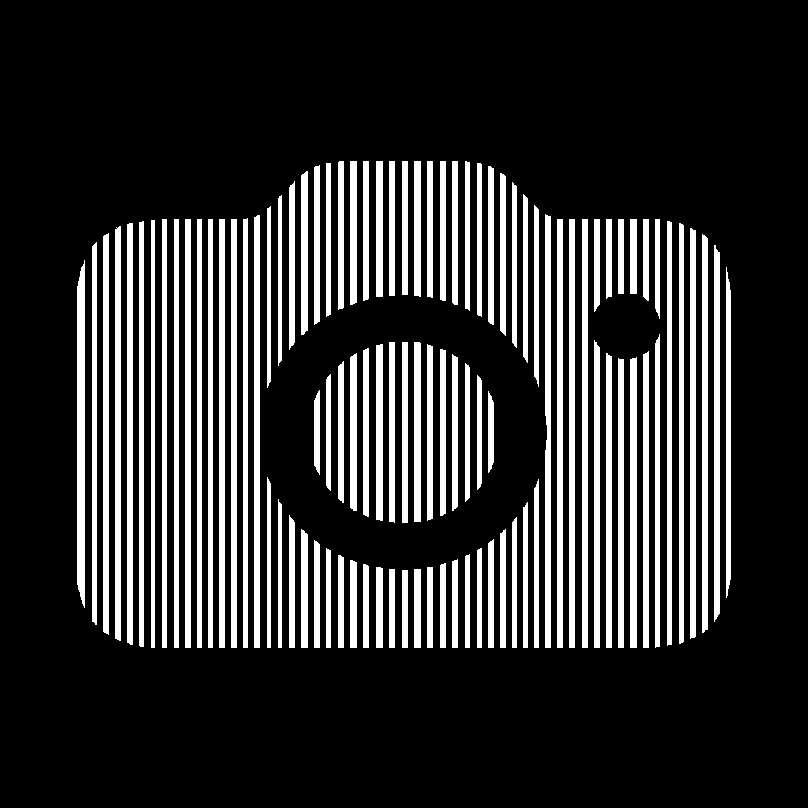

<p align="center">
  
</p>

<h1 align="center">CaptureAll</h1>

<p align="center">
  <strong>Native macOS menu-bar capture.</strong><br />
  Screenshots · screen recording · mic & system audio — driven by hotkeys.
</p>

<p align="center">
  
  
  
  
</p>

---

CaptureAll lives in the menu bar. No Dock clutter. Press a chord, pick full / window / area, and you’re done — stills to disk & clipboard, video with microphone and system audio via **ScreenCaptureKit**.

On macOS 26+, chrome uses **Liquid Glass**; earlier releases fall back to native materials.

## Features

| | |
|---|---|
| **Stills** | Full screen, window, or area — save under `~/Pictures/CaptureAll`, clipboard on by default |
| **Video** | Window or area recording with `SCStream` + `AVAssetWriter` → `~/Movies/CaptureAll` |
| **Audio** | Microphone + system / game audio (when the OS / SCK path allows) |
| **Hotkeys** | Global chords for screenshot, record toggle, and selection mode |
| **Menu bar** | Camera status item — Screenshot / Recording / Settings without a main window |
| **Native UI** | Liquid Glass panels on macOS 26+; material fallback earlier |

## Defaults

| Action | Shortcut |
|--------|----------|
| Screenshot | `⌘⇧A` |
| Recording (start / stop) | `⌘⇧S` |
| Previous / next selection mode | `⌘⇧X` / `⌘⇧C` |

Selection modes: **Full** · **Window** · **Area**

## Requirements

- macOS **13+** (Liquid Glass chrome on **macOS 26+**)
- **Xcode 26+** to build from source
- **Screen Recording** permission (stills + video)
- **Microphone** permission (optional, for voice in recordings)

## Quick start

```bash
./scripts/run.sh
```

That builds a signed app, installs it to **`/Applications/CaptureAll.app`**, and launches it with `open`.

> Always launch the `.app` (script or double-click). Do **not** run `Contents/MacOS/CaptureAll` directly — the menu-bar item may never appear.

**Or in Xcode:** open `CaptureAll.xcodeproj` → Run  
(project sets `ENABLE_DEBUG_DYLIB=NO` so the app starts correctly outside the debugger).

### Menu bar tip (macOS 26)

System Settings → **Menu Bar** must allow CaptureAll. If the camera icon is missing, enable it there (the app can open that pane when it detects a block). Look **top-right**, near Wi‑Fi.

## Architecture

```
AppShell            Status item, capture orchestration, idle auto-quit
HotkeyCenter        Global Carbon hotkeys
GlassUI             Liquid Glass / material panels, toasts, recording badge
SelectionOverlay    Full / window / area targeting
StillCaptureService ScreenCaptureKit stills
VideoCaptureService SCStream + AVAssetWriter
AudioMixer          Microphone capture
ExportStore         Paths, bookmarks, naming, clipboard
SettingsStore       Codable prefs (hotkeys, audio, FPS, …)
```

## Project layout

```
CaptureAll/
├── CaptureAll/          # Swift sources by module
├── CaptureAll.xcodeproj
├── scripts/             # run.sh · package-dmg.sh · generate-icons.py
├── assets/              # README art
└── dist/                # local build output (gitignored)
```

## License

MIT — see [LICENSE](LICENSE).
